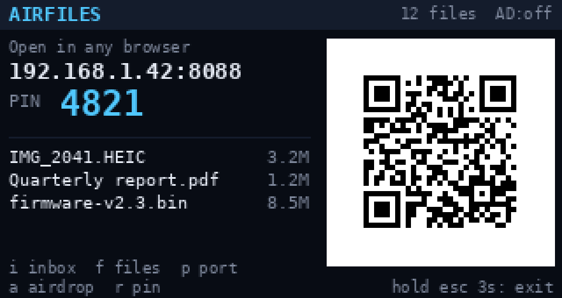
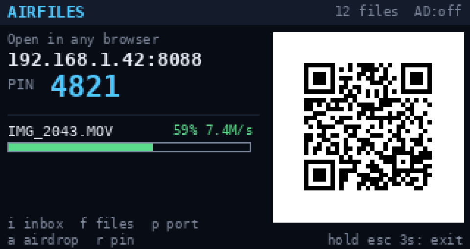
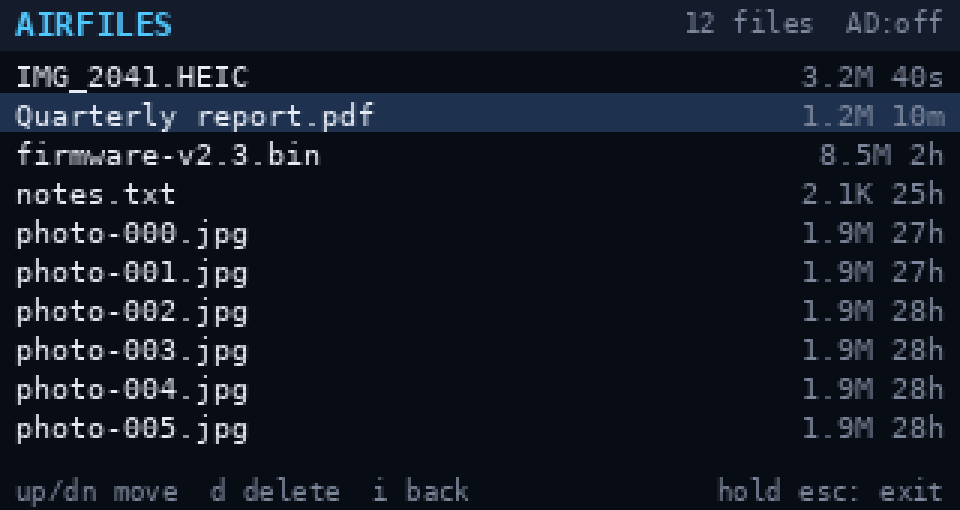
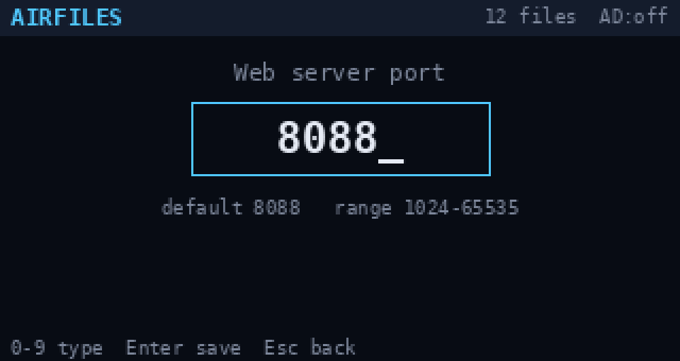
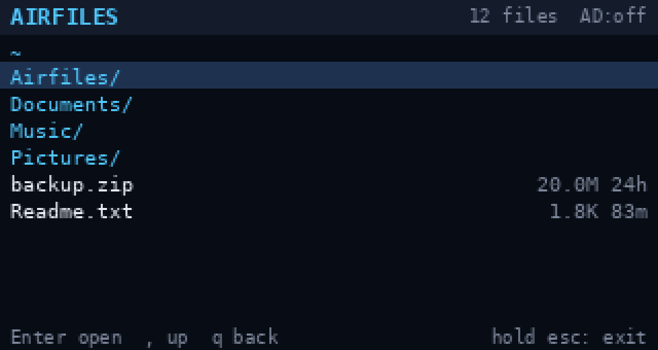
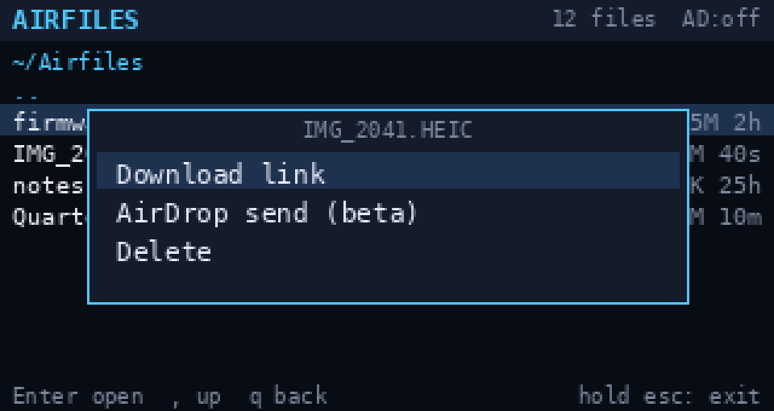
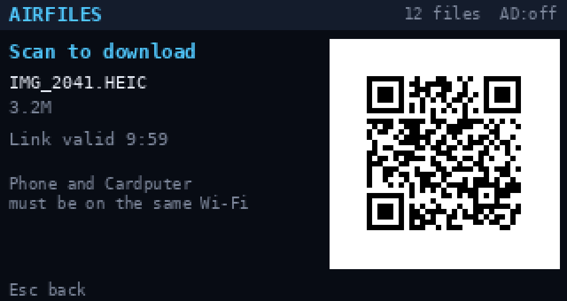
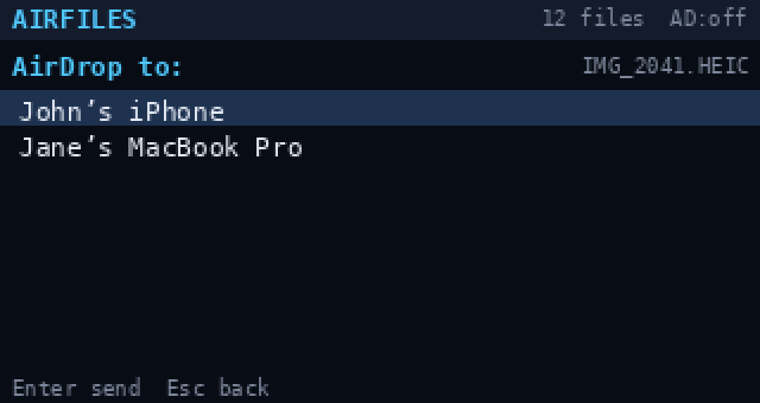

# Airfiles

**Transfer files on the M5Stack CardputerZero from an iPhone, Android SmartPhone or any computer.**

Airfiles puts a QR code and a PIN on the CardputerZero's 320x170 screen. Scan the
code with a phone, pick files in the browser, and they land in `~/Airfiles` on the
device. No app is needed on the phone, and it works the same for iPhone, Android,
Windows, macOS, Linux and `curl`.

<p align="center">
  
  
</p>
<p align="center">
  
  
</p>

<p align="center">
  
  
</p>
<p align="center">
  
  
</p>

> The images are renders of the app's real 320x170 framebuffer output (shown at 3x),

## Features

- **Phone-friendly:** scan the QR code, tap to choose files, watch the progress bar on both screens.
- **Any client:** a plain browser page, `curl`, or iOS Shortcuts. Nothing to install on the sender.
- **PIN protected:** the QR link carries a random 4-digit PIN. Ten wrong PINs from one address lock it out for a minute.
- **Safe file handling:** names are sanitised (no path tricks, no hidden files), duplicates become `name-1.ext`, partial uploads are never left in the inbox, and a size limit and free-space check apply.
- **Files browser:** press `f` to browse the device from your home folder down. Open any file to get a **download link with a QR code** (for a phone or computer) or to **send it by AirDrop (beta)**. Files in the inbox can also be deleted.
- **Configurable port:** default `8088`, changeable on the device (press `p`) and remembered.
- **Built for the small screen:** 320x170 framebuffer UI, keyboard-only control, hold Esc for 3 s to exit.
- **Experimental AirDrop:** optional, off by default, via OWL + OpenDrop (see below).

## Requirements

- M5Stack CardputerZero running Debian trixie with APPLaunch (arm64)
- Wi-Fi, with the sending device on the same network
- Installed automatically by the package: `python3`, `python3-pil`, `python3-numpy`, `python3-evdev`, `python3-qrcode`, `fonts-dejavu-core`
- The user running the app needs access to the screen and keyboard (normally the `video` and `input` groups, which the default `pi` user has)

## Install

**From a release** (recommended): download `airfiles_<version>_arm64.deb` from the
[Releases](../../releases) page, copy it to the device, then:

```sh
sudo apt install ./airfiles_<version>_arm64.deb
```

Open **Airfiles** from APPLaunch, or run `airfiles` from an SSH session.

**Build it yourself** (any Linux machine with `dpkg-deb`, no cross-compiler needed):

```sh
MAINTAINER="Your Name <you@example.com>" bash build-deb.sh   # writes dist/airfiles_<version>_arm64.deb
```

**Run from source** (no install):

```sh
sudo apt install python3 python3-pil python3-numpy python3-evdev python3-qrcode fonts-dejavu-core
python3 airfiles.py
```

## Using it

1. Open Airfiles. The screen shows an address, a PIN and a QR code.
2. On the phone, scan the QR code (the iPhone camera works), or type the address and PIN.
3. Tap **Tap to choose files**, pick one or more, and wait for each to finish.
4. Files appear in `~/Airfiles` and in the app's inbox (`i`).

### Browse files and send them out

1. Press `f` on the home screen. The browser opens in the inbox; `,` (or Backspace) goes up a folder,
   `Enter` opens a folder, and the top folder is your home directory (`browse_root`). Hidden files are not shown.
2. Press `Enter` on a file to open its menu:
   - **Download link** shows a QR code. Scan it on a phone or computer on the same network to download
     the file. The link works for 10 minutes (`share_minutes`) and still needs the PIN, which is inside the link.
   - **AirDrop send (beta)** looks for nearby Apple devices and sends the file to the one you pick.
     AirDrop must be switched on first (see below).
   - **Delete** appears for files in the inbox only and asks for a second `Enter`.
3. `Esc` steps back one level; `q` goes back to the home screen.

### From the command line

```sh
curl -T photo.jpg "http://<device-ip>:8088/upload/photo.jpg?pin=<pin>"
curl -F "file=@report.pdf" "http://<device-ip>:8088/upload?pin=<pin>"   # one file per request
curl -o back.jpg "http://<device-ip>:8088/files/photo.jpg?pin=<pin>"    # download a file again
```

### From iOS Shortcuts

Use **Get Contents of URL** with the URL `http://<device-ip>:8088/upload/<name>?pin=<pin>`,
method **POST** (or PUT) and Request Body **File**. The same Shortcut can be added to
the share sheet. *(Written from the HTTP behaviour; not yet tested on an iPhone.)*

### HTTP API

| Request | What it does |
|---|---|
| `GET /` | the upload page |
| `PUT` or `POST /upload/<name>` | raw body is the file (also accepts `?name=` or an `X-Filename` header) |
| `POST /upload` with `multipart/form-data` | one file per request |
| `GET /files` | JSON list of received files |
| `GET /files/<name>` | download a received file |
| `GET /dl/<token>` | download a file shared from the Files browser (expires; needs the PIN) |

Every request needs the PIN as `?pin=1234` or an `X-Pin` header. Responses use ordinary HTTP errors:
`401` bad or missing PIN, `411` missing `Content-Length`, `413` file too large, `507` not enough space.

## Keys

| Key | Action |
|---|---|
| `i` or `Tab` | open / close the inbox |
| `f` | open the Files browser |
| in Files: `;` / `.` | move up / down |
| in Files: `Enter` or `/` | open a folder, or the menu for a file |
| in Files: `,` or `Backspace` | up one folder |
| `;` or `Up`, `.` or `Down` | move in the inbox |
| `d` (press twice) or `Backspace` | delete the selected file |
| `p` | change the web port (type digits, `Enter` saves) |
| `r` | generate a new PIN |
| `a` | toggle AirDrop (experimental) |
| `Esc` (tap) | go back |
| `q` | quit (from the home screen) |
| **hold `Esc` for 3 s** | exit from anywhere (a progress box shows while you hold) |

The backtick key is treated as `Esc` too, because the CardputerZero's key code for Esc is
not confirmed (see `esc_keys` below).

## Configuration

Optional file `~/.config/airfiles/config.json` (override the path with `AIRFILES_CONFIG`).
Changing the port from the app writes `"port"` here for you.

| Key | Default | Meaning |
|---|---|---|
| `port` | `8088` | web server port (1024-65535) |
| `inbox` | `~/Airfiles` | where received files are saved |
| `pin` | `true` | require a PIN |
| `max_mb` | `2048` | per-file size limit |
| `airdrop` | `false` | start OWL + OpenDrop at launch |
| `airdrop_iface` | `wlan1` | Wi-Fi adapter OWL may take over |
| `fb` | `/dev/fb0` | framebuffer device |
| `rotate` | `0` | `0`/`90`/`180`/`270` if the panel is rotated |
| `browse_root` | `~` | top folder the Files browser may open |
| `share_minutes` | `10` | how long a download link stays valid |
| `exit_hold_s` | `3.0` | seconds to hold Esc to exit |
| `esc_keys` | `["KEY_ESC","KEY_GRAVE"]` | evdev key names that act as Esc |

Environment: `AIRFILES_KBD=/dev/input/eventN` forces a keyboard device;
`AIRFILES_OPENDROP_CMD` overrides the OpenDrop command.

Command line: `airfiles --headless` (server only, no screen or keyboard, handy over SSH),
`airfiles --port 9000`, `airfiles --preview out.png [home|active|inbox|port|exiting]`.

## AirDrop (experimental)

Real AirDrop uses Apple's AWDL wireless protocol. On Linux it works only through the open-source
[OWL](https://github.com/seemoo-lab/owl) and [OpenDrop](https://github.com/seemoo-lab/opendrop)
projects, which need a Wi-Fi adapter that supports monitor mode. Airfiles starts and stops them
and wraps `opendrop find` / `opendrop send` in the Files menu. It does nothing else with AirDrop.

- **Switch on:** press `a` (or set `"airdrop": true`). The title bar shows `AD:listening` when it is up.
- **Hardware:** use a **second USB Wi-Fi adapter** (set `airdrop_iface`, default `wlan1`). OWL takes the adapter
  over, so the built-in Wi-Fi stays on your network for the web page.
- **Install:** `owl` and `opendrop` must be installed. OWL runs through `sudo -n`, so give your user passwordless
  `sudo` for `owl` and `pkill` (or run Airfiles as root). OpenDrop runs as the normal user.
- **Receive:** the iPhone must be set to receive from **Everyone** with the share sheet or AirDrop open.
  Received files are saved where OpenDrop puts them; Airfiles starts it in the inbox. Check `~/.opendrop/`
  if nothing shows up.
- **Send:** in Files, open a file, choose **AirDrop send (beta)**, wait for the device list, pick one and press
  `Enter`. The screen shows OpenDrop's progress lines and ends with Sent or Failed. `Esc` cancels.
- **Log:** `~/.cache/airfiles/airdrop.log`.
- Newer iOS versions may need a patched OpenDrop; this has not been verified.

**AirDrop receive and send are untested on real hardware.** The send flow is tested against a stand-in
`opendrop` program (it checks the commands Airfiles runs and how it handles success, failure and cancel),
but not against an iPhone. The browser upload and the download links are the supported ways to move files
to and from a phone.

## Security notes

- Traffic is plain HTTP on your local network, with no encryption. Use trusted networks only.
- Do not forward the port to the internet.
- The PIN stops casual access. It is 4 digits, so treat it as a door latch, not a vault. Press `r` for a new one.
- Download links expire after `share_minutes`, are random, and still need the PIN. The Files browser cannot
  leave `browse_root`, and links that point outside it are hidden. Anyone who has a link can download that one file.
- Anything uploaded is saved as-is. Airfiles never runs or opens received files.

## Files and paths

| Path | Contents |
|---|---|
| `~/Airfiles` | received files (temporary `.part` files while uploading) |
| `~/.config/airfiles/config.json` | optional settings |
| `~/.cache/airfiles/airdrop.log` | OWL/OpenDrop output |
| `/usr/lib/airfiles/airfiles.py` | the program (package install) |
| `/usr/share/APPLaunch/applications/airfiles.desktop` | APPLaunch entry |

## Development

```sh
python3 -m unittest -v                    # 48 tests: server, PIN, uploads, port, Esc hold, Files, links, AirDrop send
python3 airfiles.py --headless --port 9000     # run the server without a device
python3 tools/make_screenshots.py         # regenerate docs/screenshots (QR needs python3-qrcode or reportlab)
python3 tools/make_icon.py 64 assets/airfiles.png
bash build-deb.sh                            # build the .deb
```

The whole program is one file, `airfiles.py` (standard library plus Pillow, numpy, evdev
and qrcode). The tests need only Python 3 and Pillow; no device or display.

Project layout:

```
airfiles.py            the app: web server, 320x170 UI, framebuffer, keyboard, AirDrop wrapper
build-deb.sh           packages the app for APPLaunch / apt
assets/airfiles.png    launcher icon (64x64)
docs/screenshots/      README images
.github/workflows/     CI: tests on every push, .deb attached to releases
```

To publish to the CardputerZero app store, build the `.deb` with a real maintainer email and use
M5Stack's `czdev publish --deb <file>` (see their
[CardputerZero-AppBuilder](https://github.com/m5stack/CardputerZero-AppBuilder) docs).

## Status

- The web server, PIN lockout, file handling, port editor, Esc-hold exit, Files browser, download links,
  AirDrop send (against a fake `opendrop`) and screen rendering are covered by automated tests, and the QR code drawn on screen has been checked to decode to the
  right address.
- **Not yet confirmed on real hardware:** how APPLaunch hands over the screen and keyboard to an
  external app, the exact key code of the Esc key, and the AirDrop path. Please open an issue with
  what you see on your device.

## License

MIT, see [LICENSE](LICENSE).

Airfiles is an independent project and is not affiliated with or endorsed by M5Stack or Apple.
AirDrop is a trademark of Apple Inc.
